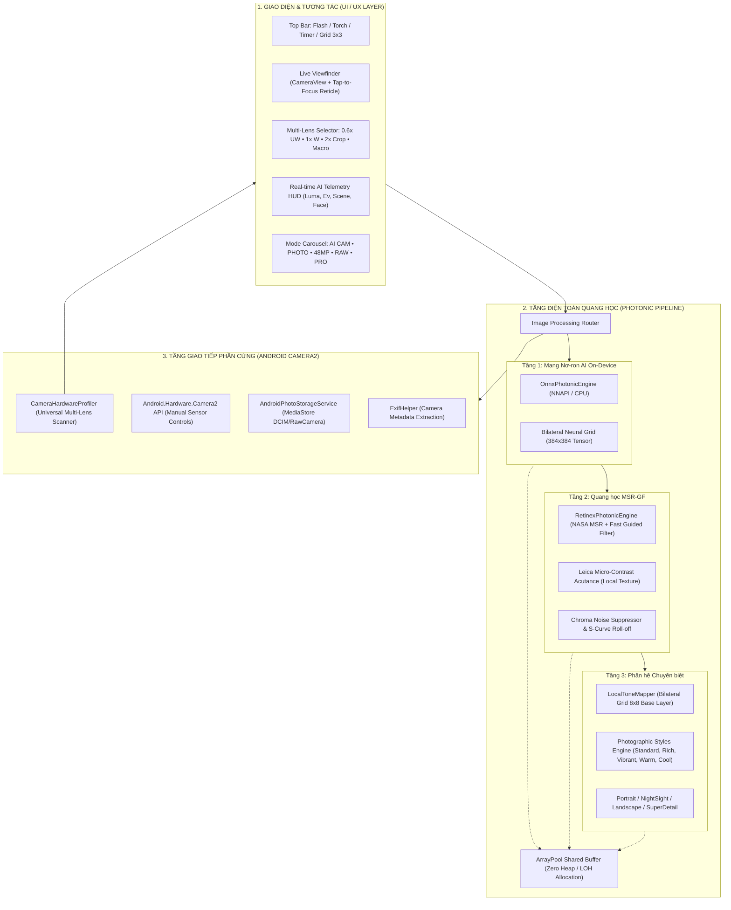

# RAW • PRO (RawCameraApp)

<p align="center">
  
</p>

<p align="center">
  <b>Ứng dụng máy ảnh chuyên nghiệp thế hệ mới (Next-Gen Computational Camera)</b><br />
  Xây dựng trên nền tảng <b>.NET 9 MAUI</b> &amp; <b>Android Camera2 API</b><br />
  Mang sức mạnh nhiếp ảnh điện toán cao cấp, mạng nơ-ron AI On-Device và điều khiển quang học chuẩn Studio đến thiết bị di động.
</p>

<p align="center">
  
  
  
  
  
</p>

---

## 📑 Mục lục
1. [Tổng quan dự án](#-tổng-quan-dự-án)
2. [Sơ đồ Kiến trúc & Động cơ Điện toán (Architecture)](#-sơ-đồ-kiến-trúc--động-cơ-điện-toán)
3. [Các chế độ chụp chuyên biệt (Shooting Modes)](#-các-chế-độ-chụp-chuyên-biệt)
4. [Động cơ Tính toán Xử lý Ảnh (Photonic Engine Pipeline)](#-động-cơ-tính-toán-xử-lý-ảnh-photonic-engine)
5. [Hệ thống Quét & Nhận diện Đa Ống Kính (Universal Multi-Lens Profiler)](#-hệ-thống-quét--nhận-diện-đa-ống-kính)
6. [Phòng tối Hậu kỳ RAW • PRO AI Studio](#-phòng-tối-hậu-kỳ-raw--pro-ai-studio)
7. [Quản lý Thư viện Ảnh & Thanh tra Siêu dữ liệu EXIF](#-quản-lý-thư-viện-ảnh--thanh-tra-siêu-dữ-liệu-exif)
8. [Tối ưu hóa Phần cứng & Trải nghiệm Người dùng](#-tối-ưu-hóa-phần-cứng--trải-nghiệm-người-dùng)
9. [Yêu cầu Môi trường & Hướng dẫn Cài đặt](#-yêu-cầu-môi-trường--hướng-dẫn-cài-đặt)
10. [Tự động hóa Kiểm thử với ADB Intent](#-tự-động-hóa-kiểm-thử-với-adb-intent)

---

## 🌟 Tổng quan dự án

**RAW • PRO** được thiết kế nhằm khai phóng toàn bộ tiềm năng phần cứng của cảm biến camera trên điện thoại Android (đặc biệt tối ưu hóa cho dòng chip Qualcomm Snapdragon và cảm biến Sony Quad-Bayer như IMX582/IMX686 trên Poco X3 Pro và các thiết bị tương đương).

Thay vì phụ thuộc vào thuật toán làm mịn hoặc tăng bão hòa quá đà của các ứng dụng camera mặc định, **RAW • PRO** xây dựng một chuỗi xử lý quang học đồng bộ (Synchronized Photonic Pipeline):
- **Bảo toàn chi tiết vi mô:** Giữ lại kết cấu thực tế của bề mặt và da mặt (Pore-Preserving Texture).
- **Mở rộng dải tương phản (Dynamic Range):** Tái tạo vùng cháy sáng mượt mà (Highlight Roll-Off S-Curve) và kéo sáng vùng tối không nhiễu hạt.
- **Xử lý AI On-Device 100% Offline:** Không gửi bất kỳ dữ liệu hình ảnh nào ra bên ngoài, đảm bảo quyền riêng tư tuyệt đối và phản hồi tức thì.

---

## 🏛 Sơ đồ Kiến trúc & Động cơ Điện toán

Hệ thống được tổ chức thành 3 tầng phân tách độc lập (Separation of Concerns) nhằm đảm bảo hiệu năng thời gian thực và quản lý tài nguyên nghiêm ngặt:



---

## 📷 Các chế độ chụp chuyên biệt

Ứng dụng cung cấp 5 chế độ chụp ảnh được tinh chỉnh cho từng mục đích sử dụng cụ thể:

### 1. 🤖 AI CAM (Nhiếp ảnh Điện toán Thông minh)
Tự động kích hoạt chuỗi tính toán 3 tầng kết hợp trí tuệ nhân tạo và quang học Retinex.
- **Phân tích bối cảnh thời gian thực (Real-time Scene Analysis):** Tự động nhận diện Chân dung (`Portrait`), Cảnh đêm (`NightLowLight`), Ngược sáng (`BacklitHdr`), Phong cảnh trời xanh (`LandscapeSky`), Cây cối thiên nhiên (`FoliageNature`), Đồ ăn tông ấm (`FoodWarm`).
- **Telemetry HUD:** Hiển thị trực tiếp các thông số quang học trên khung ngắm:
  - Chỉ số độ sáng trung bình (Mean Luma) và phân bổ vùng tối/sáng (Shadow/Highlight Ratio).
  - Độ phủ da mặt (Skin Coverage) và số lượng khuôn mặt (Face Count).
  - Đề xuất bù trừ phơi sáng (Recommended EV Shift) và thời gian suy luận (Processing Time ms).
- **5 chế độ tinh chỉnh AI con:**
  - `Auto`: Tự động thích ứng linh hoạt theo bối cảnh môi trường.
  - `Chân dung (Portrait)`: Làm đẹp da giữ kết cấu lỗ chân lông (`Bilateral Pore-Preserving`), tôn tông màu da tự nhiên và tạo bokeh xóa phông quang học mềm mại.
  - `Chụp đêm (NightSight)`: Cân bằng chiếu sáng thiếu sáng `Zero-DCE` kết hợp khử nhiễu không gian đa tầng (`Spatial Denoise`).
  - `Phong cảnh (Landscape)`: Tăng sắc độ trời xanh ngọc (`Deep Cyan-Blue`) và sắc lá xanh biếc (`Lush Emerald`).
  - `Siêu nét (SuperDetail)`: Nâng độ sắc nét vi mô thích ứng cạnh (`Edge-Aware Unsharp`) và khử lớp mờ sương mù (`Dehaze`).

### 2. 🎨 PHOTO (Chụp ảnh Tiêu chuẩn & Photographic Styles)
Chế độ chụp ảnh tức thì mô phỏng các phong cách xử lý màu điện ảnh danh tiếng:
- **Tiêu chuẩn (Standard):** Giữ cân bằng màu trung tính, độ tương phản dịu mắt chuẩn quang học.
- **Tương phản cao (Rich Contrast):** Làm sâu vùng tối, nâng vi tương phản tạo chiều sâu kịch tính.
- **Rực rỡ (Vibrant):** Tăng cường độ bão hòa có chọn lọc cho các tông màu nhạt mà không làm biến dạng màu da.
- **Tông ấm (Warm):** Thêm sắc vàng hổ phách tinh tế, phù hợp hoàng hôn hoặc khoảnh khắc ấm cúng.
- **Tông mát (Cool):** Thêm sắc xanh dịu nhẹ phong cách điện ảnh hiện đại.
- **Thuật toán bảo vệ:** Tích hợp bộ lọc bảo vệ vùng trắng tinh khôi (`Neutral Whites Guard`) và vùng đen sâu (`Pure Blacks Guard`).

### 3. 🔍 48MP (Ultra HD Siêu độ phân giải)
- Khai thác luồng dữ liệu phân giải đầy đủ từ cảm biến Quad-Bayer (Sony IMX582/IMX686...).
- Bỏ qua thuật toán ghép điểm ảnh (Pixel Binning 4-in-1), giải nén toàn bộ 48 triệu điểm ảnh vật lý.
- Tối ưu cho chụp ảnh phong cảnh chi tiết cao, kiến trúc hoặc ảnh cần phóng lớn in ấn khổ lớn.

### 4. 🎞 RAW (Ảnh Thô Kỹ thuật số Không nén)
- Lưu giữ nguyên bản 100% tín hiệu ánh sáng thu được từ cảm biến mà không qua nén JPEG phá hủy dữ liệu.
- Giữ trọn dải động học cao nhất (Maximum Dynamic Range) và toàn bộ thông số hiệu chuẩn quang học.
- Sẵn sàng xuất sang các phần mềm hậu kỳ chuyên nghiệp như Adobe Lightroom, Photoshop Camera Raw, Capture One.

### 5. 🎛 PRO (Điều khiển Thủ công Chuẩn Studio)
Cho phép nhiếp ảnh gia toàn quyền kiểm soát thiết lập phơi sáng và lấy nét:
- **Shutter Speed (Tốc độ màn trập):** Tùy chỉnh từ phơi sáng lâu (1s, 1/2s, 1/4s...) đến tốc độ cao (1/1000s, 1/4000s).
- **ISO:** Điều chỉnh độ nhạy sáng thủ công từ ISO 100 đến ISO 3200+.
- **Manual Focus (Khoảng cách lấy nét):** Tinh chỉnh tiêu cự thủ công từ chụp siêu cận macro đến vô cực.
- **White Balance (Cân bằng trắng):** Tùy chỉnh nhiệt độ màu theo độ K (Kelvin).
- **Bù trừ phơi sáng (EV Compensation):** Bước nhảy ±1/3 EV từ -2.0 EV đến +2.0 EV.
- **AE / AF Lock:** Khóa phơi sáng và khóa nét độc lập bằng thao tác chạm giữ trên khung ngắm.

---

## ⚡ Động cơ Tính toán Xử lý Ảnh (Photonic Engine)

Trái tim của **RAW • PRO** là chuỗi xử lý hình ảnh quang học đa tầng được tối ưu hóa cho tốc độ thực thi cực đại:

```
[Ảnh Đầu Vào]
     │
     ▼
┌────────────────────────────────────────────────────────┐
│  TẦNG 1: ONNX PHOTONIC NEURAL ENGINE                   │
│  - Thu nhỏ lưới tensor 384x384                         │
│  - Chạy mô hình trên Qualcomm Hexagon NPU / DSP        │
│  - Tạo bản đồ khuếch đại Bilateral Neural Gain Grids   │
└────────────────────────────────────────────────────────┘
     │
     ▼
┌────────────────────────────────────────────────────────┐
│  TẦNG 2: RETINEX PHOTONIC OPTICAL ENGINE               │
│  - NASA Multi-Scale Retinex (MSR) trong miền Logarit   │
│  - Fast Guided Filter với 3 bán kính (r=2, r=7, r=18)  │
│  - Tăng cường vi tương phản Leica Micro-Contrast       │
│  - Khử nhiễu sắc độ Chroma Denoise & Highlight Roll-off│
└────────────────────────────────────────────────────────┘
     │
     ▼
┌────────────────────────────────────────────────────────┐
│  TẦNG 3: BỘ PHÂN PHỐI CHUYÊN BIỆT THEO CHẾ ĐỘ          │
│  - Local Tone Mapping: Tách lớp nền (Base Layer) 8x8   │
│  - Tái tổ hợp dải tương phản với Detail Layer          │
│  - Áp dụng Photographic Styles hoặc AI Action Filters  │
└────────────────────────────────────────────────────────┘
     │
     ▼
[Ảnh Đầu Ra Độ Phân Giải Đầy Đủ (Không Giảm Kích Thước)]
```

### Chi tiết các kỹ thuật cốt lõi:
1. **Kiến trúc Bilateral Neural Grid:**
   Thay vì chạy mạng nơ-ron nặng nề trên toàn bộ bức ảnh 12MP/48MP (gây tràn RAM và đứng máy), động cơ đưa ảnh về lưới thu nhỏ $384 \times 384$ để NPU tính toán ma trận hệ số tăng ích (Gain Grids). Sau đó, hệ số này được nội suy song tuyến (Bilinear Interpolation) áp lên từng điểm ảnh gốc với tốc độ hàng chục khung hình/giây.
2. **Bộ lọc dẫn đường nhanh (Fast Guided Filter):**
   Thay thế cho bộ lọc Gaussian truyền thống, Fast Guided Filter giữ cạnh sắc nét hoàn hảo, loại bỏ triệt để hiện tượng viền sáng giả (ringing/halo artifacts) quanh các đường ranh giới chênh sáng mạnh.
3. **Quản lý bộ nhớ Zero-Allocation qua `ArrayPool<T>`:**
   Mọi vùng nhớ đệm trung gian (lưới Luma, ma trận hệ số khuếch đại, bộ đệm lọc) đều được mượn và hoàn trả qua `ArrayPool<T>.Shared`. Ứng dụng **hoàn toàn không cấp phát mảng byte/float lớn trên Large Object Heap (LOH)**, loại bỏ triệt để tình trạng dừng giật khung hình do thu gom rác (GC Pause).

---

## 🔬 Hệ thống Quét & Nhận diện Đa Ống Kính

Module `CameraHardwareProfiler` tự động quét toàn bộ cây thiết bị phần cứng của Camera2 API:

| Tiêu cự / Loại ống kính | Tên định danh | Khẩu độ tiêu biểu | Vai trò & Tối ưu hóa phần mềm |
|---|---|---|---|
| **0.6x Ultra-Wide** | Góc siêu rộng | $f/2.2$ | Bù méo góc rộng, cân bằng độ sáng rìa ảnh |
| **1x Wide Main** | Cảm biến chính | $f/1.79$ | Kích hoạt Quad-Bayer, mở khẩu độ tối đa, thu sáng đêm |
| **2x In-Sensor Crop** | Thu phóng cảm biến | $f/1.79$ | Cắt trực tiếp vùng trung tâm cảm biến không qua nội suy kỹ thuật số |
| **Macro Lens** | Siêu cận cảnh | $f/2.4$ | Tự động kích hoạt bộ tăng cường nét vi mô `EdgeAcutanceBoost` |
| **Front Selfie** | Camera trước | $f/2.2$ | Tự động lật gương (Mirroring) và làm mịn da chân dung |

> [!NOTE]
> Hệ thống tính toán chính xác tiêu cự tương đương chuẩn phim 35mm (Focal Length in 35mm Film Equivalent) dựa trên đường chéo khung hình Full-Frame ($43.2666\text{ mm}$) và kích thước cảm biến thực tế đo bằng milimét.

---

## 🎨 Phòng tối Hậu kỳ RAW • PRO AI Studio

Tích hợp trực tiếp bên trong ứng dụng, cho phép người dùng mở ảnh vừa chụp và thực hiện các tác vụ phục chế ánh sáng cấp độ Studio:

```
┌────────────────────────────────────────────────────────┐
│               RAW • PRO AI STUDIO HUD                  │
│                                                        │
│  [Chẩn đoán AI]: Ngược sáng mạnh • Đề xuất cứu sáng    │
│  ┌──────────────────────────────────────────────────┐  │
│  │ Luma: 0.38 │ Shadow: 42% │ Sky: 18% │ Sharp: 9.4 │  │
│  └──────────────────────────────────────────────────┘  │
│                                                        │
│  [1. Auto Master]       [2. Cứu sáng chủ thể]          │
│  [3. Xóa phông AI]      [4. Bầu trời Smart HDR]        │
│  [5. Màu điện ảnh]      [6. Siêu nét vi mô]            │
│                                                        │
│  << [Gốc] ─────────────── | ─────────────── [AI] >>    │
│            (Thanh trượt so sánh trực tiếp)             │
└────────────────────────────────────────────────────────┘
```

- **Chẩn đoán thông minh (AI Photo Diagnosis):** Tự động phân tích biểu đồ Luma, tỷ lệ vùng tối/sáng, độ phủ da, độ phủ bầu trời và điểm sắc nét Laplacian để đưa ra đề xuất cải thiện tối ưu nhất.
- **6 Tác vụ AI Photonic Action:**
  1. `Auto Master`: Cân bằng tự động đường cong S-Curve, giữ chi tiết vùng sáng và mở sáng vùng tối.
  2. `Subject Relight`: Dựng mặt nạ elip/khuôn mặt, tăng sáng nhân tạo cho chủ thể theo quy luật suy giảm ánh sáng tự nhiên.
  3. `Semantic Bokeh`: Ước lượng chiều sâu ngữ nghĩa, tạo lớp mờ quang học dạng đĩa tròn mịn màng cho hậu cảnh.
  4. `Smart HDR Sky`: Nhận diện mây trời bán cầu trên, khử mờ sương và tăng cường sắc độ xanh trong trẻo.
  5. `Cinematic LUT`: Tách tông màu điện ảnh (Warm Highlights & Teal/Cyan Shadows).
  6. `Super Sharp Detail`: Tách tần số cao (High-Frequency Extraction) làm nổi khối chi tiết mắt, lông mày, hoa văn.
- **So sánh Trước / Sau:** Thanh trượt tương tác thời gian thực giúp đánh giá trực quan hiệu quả trước khi lưu.

---

## 📁 Quản lý Thư viện Ảnh & Thanh tra Siêu dữ liệu EXIF

- **Lưu trữ chuẩn Android MediaStore:** Toàn bộ ảnh được lưu tại thư mục hệ thống `DCIM/RawCamera/`, tự động xuất hiện ngay lập tức trong Google Photos, Xiaomi Gallery, Samsung Gallery.
- **Trình duyệt Lightbox:** Hỗ trợ phóng to thu nhỏ đa điểm (Pinch-to-zoom), xoay ảnh, duyệt ảnh bằng cử chỉ vuốt mượt mà.
- **Bộ lọc chuyên mục nhanh:** Lọc tức thì theo các danh mục: `All`, `AI Cam`, `48MP`, `RAW`, `Pro`.
- **Thao tác hàng loạt (Multi-Select):** Hỗ trợ chọn nhiều ảnh để chia sẻ nhanh qua các ứng dụng khác hoặc xóa dọn dẹp bộ nhớ.
- **Thanh tra EXIF toàn diện:** Đọc và hiển thị trực quan các thẻ metadata quan trọng:
  - Máy ảnh & Nhà sản xuất (Make & Model)
  - Độ nhạy sáng (ISO Speed Ratings)
  - Thời gian phơi sáng (Exposure Time, e.g. `1/250s`)
  - Khẩu độ (F-Number, e.g. `f/1.79`)
  - Tiêu cự vật lý & Tiêu cự quy đổi 35mm
  - Cân bằng trắng, Trạng thái Flash, Không gian màu, Độ phân giải và Kích thước file.

---

## 🛠 Tối ưu hóa Phần cứng & Trải nghiệm Người dùng

- **Nút chụp vật lý:** Tích hợp lắng nghe sự kiện phím tăng/giảm âm lượng (Hardware Volume Buttons) để chụp ảnh thuận tiện khi cầm ngang máy.
- **Chống tắt màn hình thông minh:** Luôn giữ màn hình sáng khi đang ở khung ngắm máy ảnh (`KeepScreenOn`) và cho phép mở camera ngay khi màn hình đang khóa (`ShowWhenLocked` & `TurnScreenOn`).
- **Giao diện chuẩn OLED Dark Mode:** Toàn bộ UI sử dụng nền đen thuần khiết (`#000000`) giúp tiết kiệm tối đa pin trên màn hình AMOLED/OLED và tôn vinh màu sắc hình ảnh hiển thị.

---

## 🚀 Yêu cầu Môi trường & Hướng dẫn Cài đặt

### Yêu cầu tiên quyết:
- **Hệ điều hành:** Windows 10/11, macOS, hoặc Linux
- **.NET SDK:** Phiên bản `.NET 9.0 SDK`
- **Workload:** `maui-android`
- **JDK:** Microsoft OpenJDK 17
- **Android SDK:** API Level 24 trở lên (Android 7.0+)
- **Thiết bị:** Điện thoại Android kết nối qua USB (đã bật chế độ `USB Debugging`)

### Các bước cài đặt nhanh:

#### Cách 1: Sử dụng Script tự động (Khuyến nghị trên Windows)
1. **Thiết lập môi trường:** Nhấp chuột phải vào file [`setup-env.bat`](file:///setup-env.bat) và chọn **Run as Administrator** để cài đặt OpenJDK 17, workload .NET MAUI và restore thư viện.
2. **Build và cài đặt lên điện thoại:** Kết nối điện thoại và chạy file [`run-on-device.bat`](file:///run-on-device.bat).

#### Cách 2: Sử dụng dòng lệnh Terminal
```bash
# 1. Cài đặt workload .NET MAUI Android
dotnet workload install maui-android

# 2. Chuyển vào thư mục dự án
cd RawCameraApp

# 3. Khôi phục các gói thư viện
dotnet restore

# 4. Biên dịch và cài đặt trực tiếp lên thiết bị Android qua ADB
dotnet build -f net9.0-android -t:Run
```

---

## 🤖 Tự động hóa Kiểm thử với ADB Intent

Ứng dụng hỗ trợ các lệnh Intent qua Android Debug Bridge (ADB) giúp việc kiểm thử tự động, chụp ảnh thử nghiệm và benchmark hiệu năng trở nên dễ dàng:

```bash
# Chuyển sang chế độ AI CAM
adb shell am start -n com.companyname.rawcameraapp/crc649c260656a9417674.MainActivity --es mode "ai"

# Chuyển sang chế độ 48MP
adb shell am start -n com.companyname.rawcameraapp/crc649c260656a9417674.MainActivity --es mode "48mp"

# Kích hoạt chụp ảnh
adb shell am start -n com.companyname.rawcameraapp/crc649c260656a9417674.MainActivity --es action "capture"

# Chuyển đổi ống kính (Góc siêu rộng 0.6x)
adb shell am start -n com.companyname.rawcameraapp/crc649c260656a9417674.MainActivity --es action "lens_uw"

# Mở phòng tối AI Studio
adb shell am start -n com.companyname.rawcameraapp/crc649c260656a9417674.MainActivity --es action "ai_studio"

# Chạy tác vụ AutoMaster trong AI Studio
adb shell am start -n com.companyname.rawcameraapp/crc649c260656a9417674.MainActivity --es action "ai_automaster"
```

---

<p align="center">
  Phát triển với niềm đam mê nhiếp ảnh và công nghệ điện toán di động.<br />
  <b>RAW • PRO — Đưa trải nghiệm máy ảnh chuyên nghiệp đến mọi tầm tay.</b>
</p>
